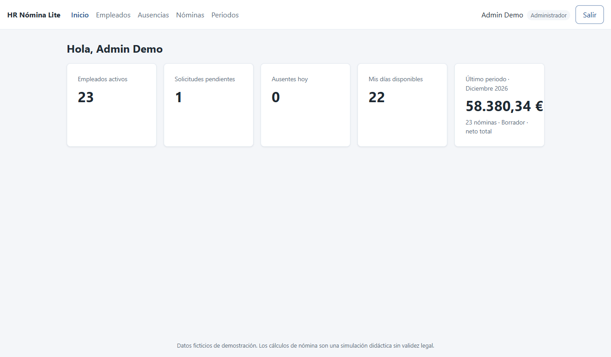
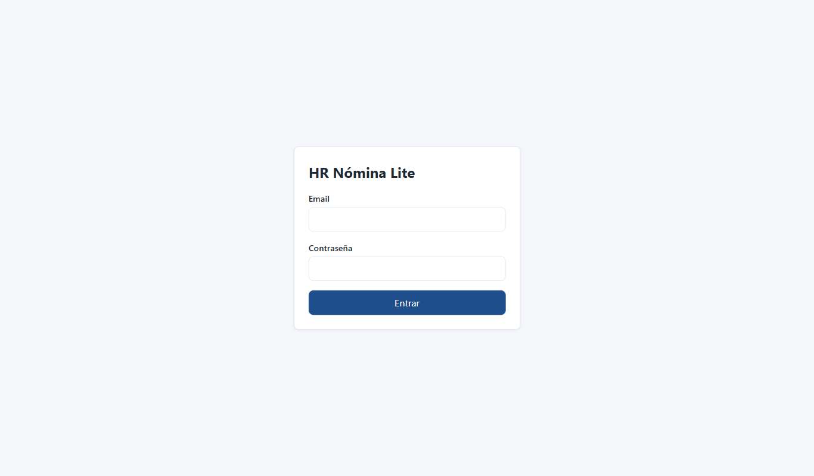
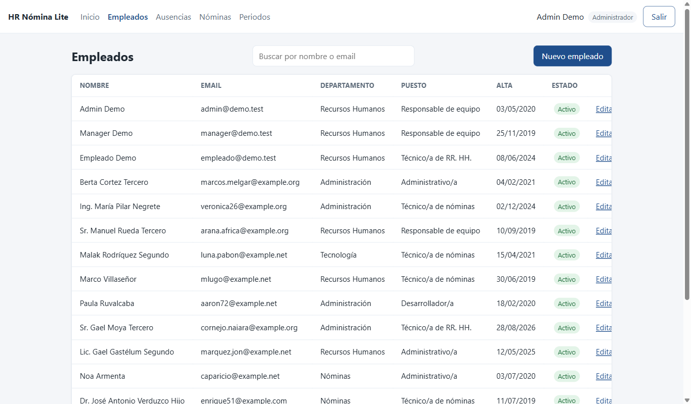
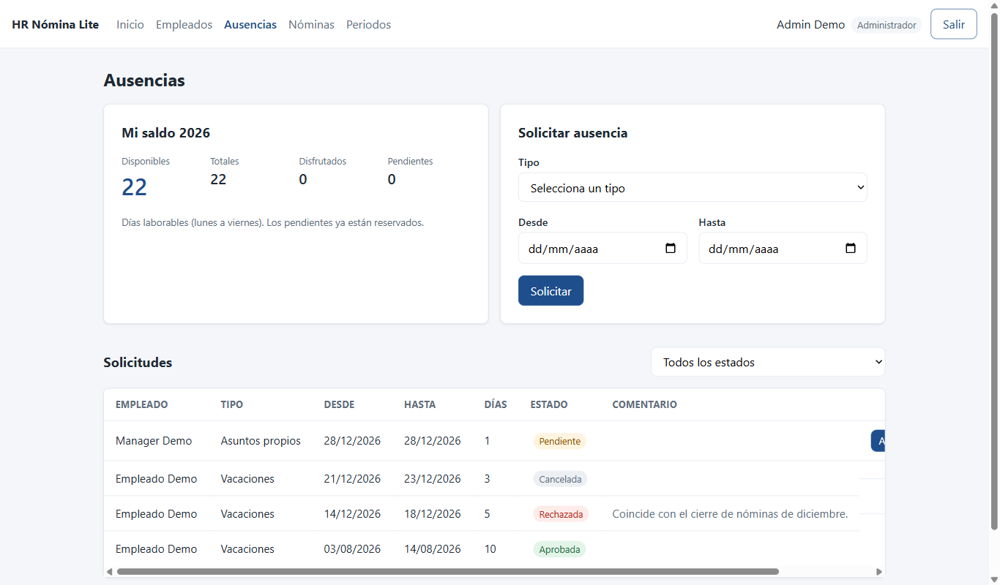
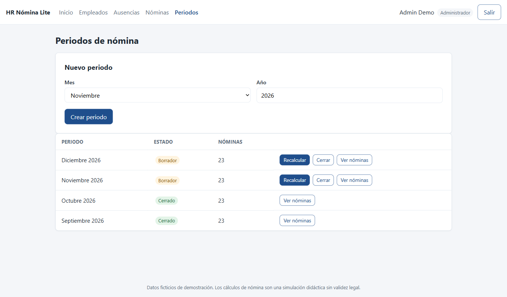
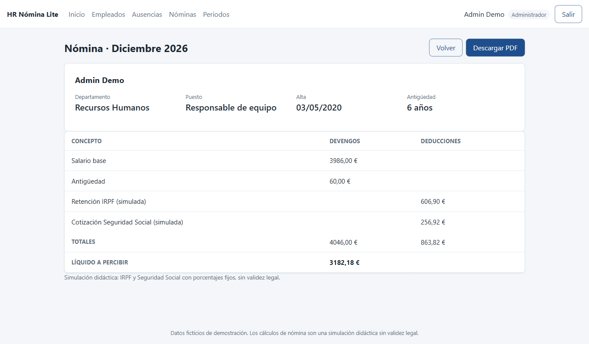
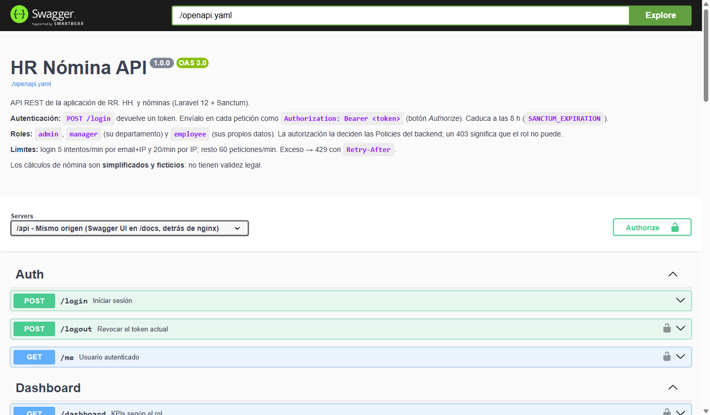
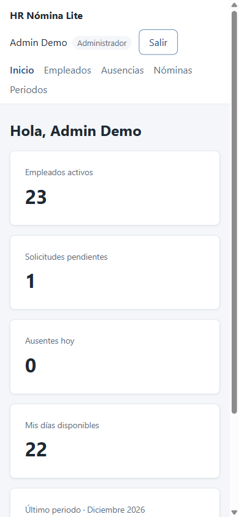

# HR Nómina Lite

Aplicación web de **Recursos Humanos y nóminas** para pymes: gestión de empleados, solicitud y aprobación de ausencias con control de saldo, cálculo de nóminas mensuales y recibos en PDF. Hay tres roles (administrador, responsable y empleado), y cada uno solo ve lo que le corresponde.

Es un proyecto de portafolio Full Stack (Vue 3 · Laravel 13 · Node.js · MySQL · Docker) construido con un flujo profesional: arquitectura por capas, decisiones documentadas, tests automatizados, revisión de seguridad OWASP y entorno reproducible.

> ⚠️ **Datos ficticios y cálculos didácticos.** El IRPF y la Seguridad Social se simulan con porcentajes fijos. Los importes **no tienen validez legal**.



## Funcionalidades

| Área | Qué hace |
|---|---|
| **Autenticación y roles** | Login con token (Sanctum, caduca a las 8 h). Roles `admin`, `manager` y `employee`; la autorización la deciden las Policies de cada recurso. |
| **Empleados** | Alta, edición, baja lógica, búsqueda y paginación. Al dar de baja a alguien se revocan sus tokens al momento. Departamentos y puestos. |
| **Ausencias** | Solicitud con cálculo de días laborables, control de saldo anual y de solapes, y aprobación o rechazo (con motivo) por el responsable del departamento. |
| **Nóminas** | Periodos mensuales: borrador → generar → cerrar. Reglas de cálculo intercambiables (salario base, antigüedad, deducciones). Cada recibo guarda un *snapshot* inmutable de los datos usados. |
| **Recibo PDF** | Lo genera un microservicio Node (pdfkit) al que solo puede llamar Laravel. |
| **Dashboard** | KPIs según el rol: plantilla activa, solicitudes pendientes, ausentes hoy, días disponibles y última nómina. |
| **API documentada** | Especificación OpenAPI 3 con Swagger UI interactivo en `/docs`. |

## Stack

| Capa | Tecnología |
|---|---|
| Frontend | Vue 3 (Composition API), Vue Router, Pinia, Vite, Axios · Vitest |
| Backend | PHP 8.3, Laravel 13, Sanctum, Eloquent · PHPUnit |
| Microservicio | Node.js 22, Express, pdfkit · `node:test` |
| Datos | MySQL 8.4, migraciones, seeders y factories |
| Infraestructura | Docker Compose, nginx (SPA + proxy inverso), Swagger UI |

## Arquitectura

```
                       ┌──────────────── Docker Compose ────────────────┐
 Navegador ──:8080──►  │  web (nginx)                                   │
                       │   ├─ /        → SPA Vue compilada              │
                       │   ├─ /api/*   → app (Laravel :8000)            │
                       │   └─ /docs    → swagger (Swagger UI)           │
                       │                                                │
                       │  app (Laravel) ──► mysql (MySQL 8.4)           │
                       │        └──token──► pdf (Node, sin puerto       │
                       │                         publicado)             │
                       └────────────────────────────────────────────────┘
```

- **Mismo origen.** nginx sirve la SPA y reenvía `/api` a Laravel, así que el navegador no necesita CORS.
- **Backend por capas.** `Route → Controller (fino) → FormRequest (validación) → Service (reglas de negocio) → Eloquent`, con `Policy` para autorizar y `API Resource` para dar forma a las respuestas.
- **Nóminas con el patrón Strategy.** `PayrollCalculator` aplica una lista de `PayrollRule` (Open/Closed: para añadir un concepto se crea una regla nueva). Se calcula en céntimos enteros y en una transacción.
- **Node aislado.** No accede a la base de datos ni recalcula importes: recibe un JSON ya validado y devuelve el PDF en streaming.

Más detalle en [ARCHITECTURE.md](ARCHITECTURE.md) y en las 27 decisiones razonadas de [DECISIONS.md](DECISIONS.md).

## Puesta en marcha

Requisitos: **Docker Desktop** (o Docker Engine con Compose v2) y Git.

```bash
git clone https://github.com/viballester/hr-nomina-lite.git
cd hr-nomina-lite
cp .env.example .env      # cambia las contraseñas y el token (openssl rand -hex 32)
docker compose up -d --build
```

El primer arranque tarda unos minutos. El contenedor `app` instala las dependencias, genera la clave de la aplicación, ejecuta las migraciones y, si `SEED_DEMO_DATA=true` y la base de datos está vacía, carga los datos de demostración. Los arranques siguientes no repiten ni duplican nada.

| URL | Qué es |
|---|---|
| http://localhost:8080 | Aplicación |
| http://localhost:8080/docs | Documentación interactiva de la API (Swagger UI) |
| http://localhost:8000 | API de Laravel directa |

### Usuarios de demostración

Contraseña de todos: `password`

| Email | Rol | Puede |
|---|---|---|
| `admin@demo.test` | Administrador | Todo: empleados, periodos de nómina y todas las ausencias |
| `manager@demo.test` | Responsable | Ver su departamento y aprobar o rechazar sus ausencias |
| `empleado@demo.test` | Empleado | Solicitar ausencias y consultar sus nóminas cerradas |

> Este Compose está pensado para **desarrollo y demostración** (`artisan serve`, código montado como volumen y credenciales demo). En producción se desactivaría `SEED_DEMO_DATA` y se usarían `APP_DEBUG=false`, PHP-FPM y secretos gestionados.

### Desarrollo del frontend con recarga en caliente

```bash
cd frontend && npm install && npm run dev   # http://localhost:5173, con proxy de /api a :8000
```

## Tests

```bash
docker compose exec app php artisan test          # backend: 102 tests (PHPUnit)
cd frontend && npx vitest run                     # frontend: 8 tests (Vitest)
cd services/pdf-service && npm test               # microservicio: 11 tests (node:test)
```

Cubren las reglas de negocio (saldo, solapes y cálculo de nómina), la autorización de cada rol, la validación de entrada, el barrido de 401 en todas las rutas protegidas, el rate limiting y el contrato con el servicio de PDF (`Http::fake`).

## Seguridad

Revisada frente al OWASP Top 10 en [docs/SECURITY.md](docs/SECURITY.md). Algunos puntos:

- Policies en cada recurso: ocultar un botón en Vue es comodidad, no seguridad.
- Rate limiting del login por email+IP; mismo mensaje para usuario inexistente y dado de baja, para no revelar qué cuentas existen.
- Tokens con caducidad y revocados al dar de baja a un empleado.
- CORS cerrado, cabeceras de seguridad (`X-Frame-Options`, `nosniff`, `no-store` en datos personales).
- Servicio interno sin puerto publicado, autenticado con un token comparado en tiempo constante.
- `composer audit` y `npm audit` sin avisos pendientes.

## Capturas

| | |
|---|---|
|  |  |
|  |  |
|  |  |



## Estructura del repositorio

```
├─ backend/               API Laravel (app/Services, Policies, Http/Requests, Resources, tests/)
├─ frontend/              SPA Vue 3 + Dockerfile multi-stage y nginx.conf
├─ services/pdf-service/  Microservicio Node de recibos PDF
├─ docker/php/            Imagen PHP y entrypoint idempotente
├─ docs/                  openapi.yaml, SECURITY.md, capturas y guías de estudio
└─ docker-compose.yml
```

## Fuera de alcance

IRPF y Seguridad Social reales, facturación, multiempresa e internacionalización. La planificación completa y las posibles ampliaciones (calendario de equipo, exportación CSV, CI con GitHub Actions…) están en [ROADMAP.md](ROADMAP.md).
